<div align="center">


<br/>


<br/>


**A browser-based command center for NDRF / SDRF rescue teams.** It combines a live drone or camera feed with in-browser human detection, Gemini-written disaster briefings, a hands-free voice assistant called **Fateh**, route planning, a weather risk engine and a searchable equipment inventory.

[Features](#-feature-tour) · [Architecture](#%EF%B8%8F-architecture) · [Pipelines](#-pipelines) · [API](#-api-reference) · [Quick start](#-quick-start) · [Deploy](#%EF%B8%8F-deployment-render) · [Known issues](#-code-health--known-issues)

</div>


## 🚨 Why this exists

In the first hours after an earthquake, flood or building collapse, a field commander has to answer the same questions again and again. **Where are the people? How dangerous is it? Who and what do I send? How do I get there? Is the weather about to make it worse?**

The NDRF Base Station brings those answers onto one screen that runs on a laptop at the incident site:

| Question | How the base station answers it |
|---|---|
| 👀 *Where are the people?* | A live camera or drone feed with **COCO-SSD object detection** running in the browser, plus a **human-only** filter. |
| 🧠 *What am I looking at?* | One click sends the frame to **Google Gemini**, which returns a structured **tactical briefing** with a risk level. |
| 🗺️ *How do we get there?* | **Google Directions** for the live UI, with a backend **OpenRouteService + Folium** path and an offline Haversine fallback. |
| 🌦️ *Is it safe to fly or deploy?* | **Open-Meteo** weather runs through a rule-based **risk engine** (flood, high wind, heat). |
| 📦 *What do we have?* | A 100-item rescue **equipment inventory** with instant search. |
| 🎤 *Hands busy?* | **Fateh**, a voice assistant built on the Web Speech API, runs the whole console by voice. |


## ✨ Feature tour

<div align="center">
</div>

| | Feature | What it does | Where it lives |
|---|---|---|---|
| 📹 | **Live camera / drone feed** | `getUserMedia` at 1280×720 using the rear camera. Bounding boxes are coloured by class: person 🟢, car 🟠, everything else 🔵. | [`render2.js` › `startCamera`](frontend/render2.js#L194) |
| 🎯 | **In-browser detection** | TF.js **COCO-SSD (mobilenet_v2)** runs inside a `requestAnimationFrame` loop, throttled to one inference every **100 ms**. Includes a human-only mode and a box toggle. | [`render2.js` › `startDetection`](frontend/render2.js#L278) |
| 🧠 | **AI image analysis** | Upload a photo or grab the live frame. Gemini returns **Observations · Immediate actions · Team · Strategy · Equipment · Risk level**. | [`app.py` › `/analyze_image`](backend/app.py#L280) |
| 🎤 | **Voice assistant “Fateh”** | Continuous `en-IN` speech recognition feeds a 12-rule intent router, and replies are spoken with `SpeechSynthesis`. | [`render2.js` › `takeCommand`](frontend/render2.js#L1020) |
| 🗺️ | **Route planning** | Accepts a place name or `lat,lng`, then draws a Google Directions driving route from the Dehradun base with distance and ETA. | [`render2.js` › `generateRoute`](frontend/render2.js#L662) |
| 🌦️ | **Weather risk engine** | Open-Meteo readings are checked against thresholds and turned into an **AI decision** with a risk bar and an audible alert on HIGH. | [`render2.js` › `disasterDecisionSystem`](frontend/render2.js#L958) |
| 📦 | **Equipment inventory** | 100 items in 10 categories (water rescue, medical, rope rescue, communication, heavy equipment, and more), each with quantity, status and location. | [`render2.js` › `equipmentDatabase`](frontend/render2.js#L53) |
| 🖼️ | **Trained model gallery** | Results from a custom-trained thermal and drone detector: people in debris, and people or animals behind walls. | [`index.html` › Model Gallery](frontend/index.html#L239) |
| 📜 | **Live logs & alerts** | Timestamped system log, dashboard alert feed, uptime counter and clock. | [`render2.js` › `addLog`](frontend/render2.js#L1157) |


## 🏗️ Architecture

<div align="center">
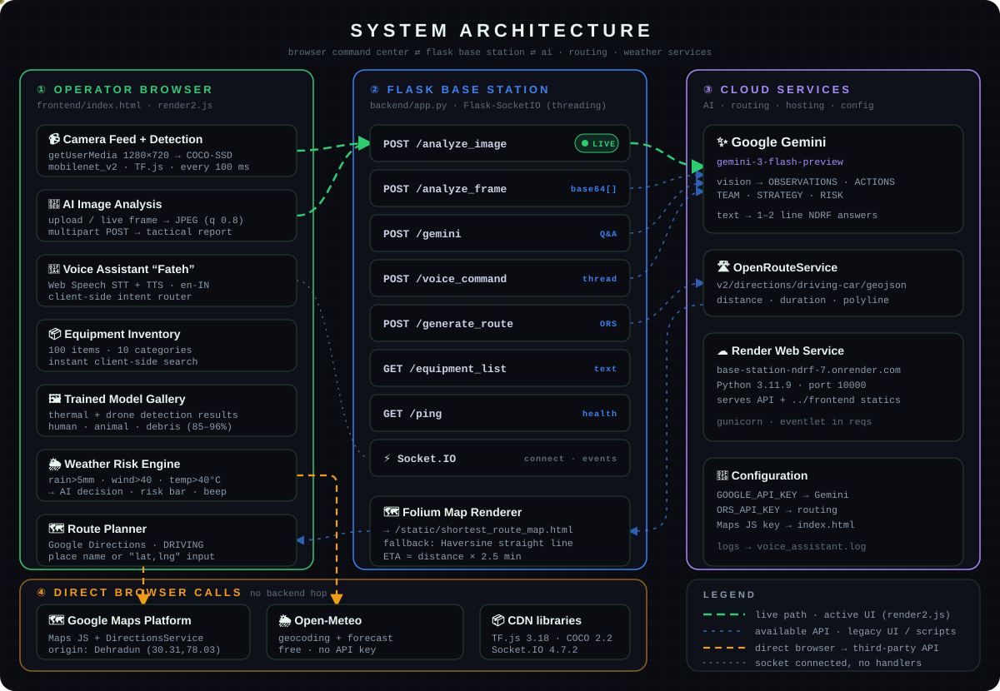
</div>

**How it fits together**

- **① Operator browser.** [`frontend/index.html`](frontend/index.html) together with [`render2.js`](frontend/render2.js) is the live UI. Camera detection, the voice router, equipment search and the weather engine all run **on the client**, so they keep working when the backend is slow.
- **② Flask base station.** [`backend/app.py`](backend/app.py) serves the frontend as static files, exposes a REST and Socket.IO API, and holds the Gemini, ORS and Folium integrations. In the current UI, **image analysis is the only feature that calls the backend** (the green path). The other endpoints serve the legacy UI ([`index2.html`](frontend/index2.html) + [`script2.js`](frontend/script2.js)) and any outside client.
- **③ Cloud services.** **Gemini** handles vision and text, **OpenRouteService** handles backend routing, and **Render** hosts the service.
- **④ Direct calls.** **Google Maps** and **Open-Meteo** are called straight from the browser and never go through the backend.

<details>
<summary><b>📐 Same architecture as a Mermaid graph (renders natively on GitHub)</b></summary>

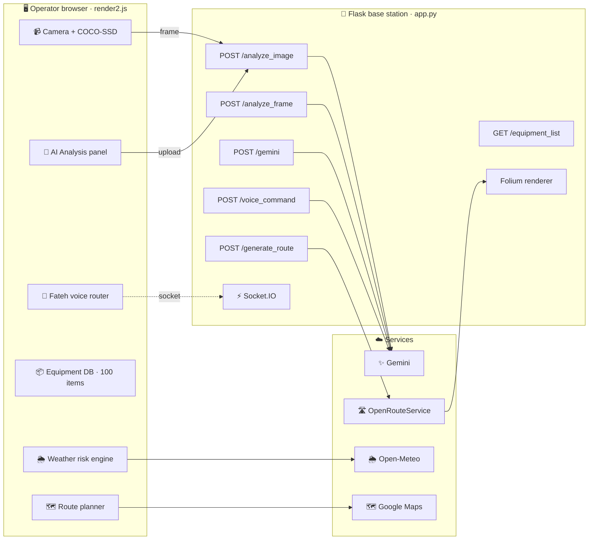

</details>


## 🔁 Pipelines

### 1 · AI image analysis: from pixels to a rescue plan

<div align="center">
</div>

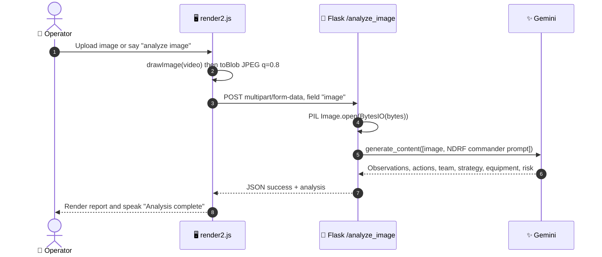

The prompt casts Gemini as an *NDRF disaster response commander* and asks for a fixed set of sections, so the output reads like a tactical brief rather than a caption:

```text
🔍 OBSERVATIONS      what is visible · damage · hazards · trapped people
🚨 IMMEDIATE ACTIONS what must happen right now
👥 TEAM REQUIRED     personnel count · specialised units
🗺️ STRATEGY          step-by-step rescue plan
📦 EQUIPMENT NEEDED  specific tools and supplies
⚠️ RISK LEVEL        LOW / MEDIUM / HIGH / CRITICAL
```

---

### 2 · Voice commands: Fateh's intent router

<div align="center">
</div>

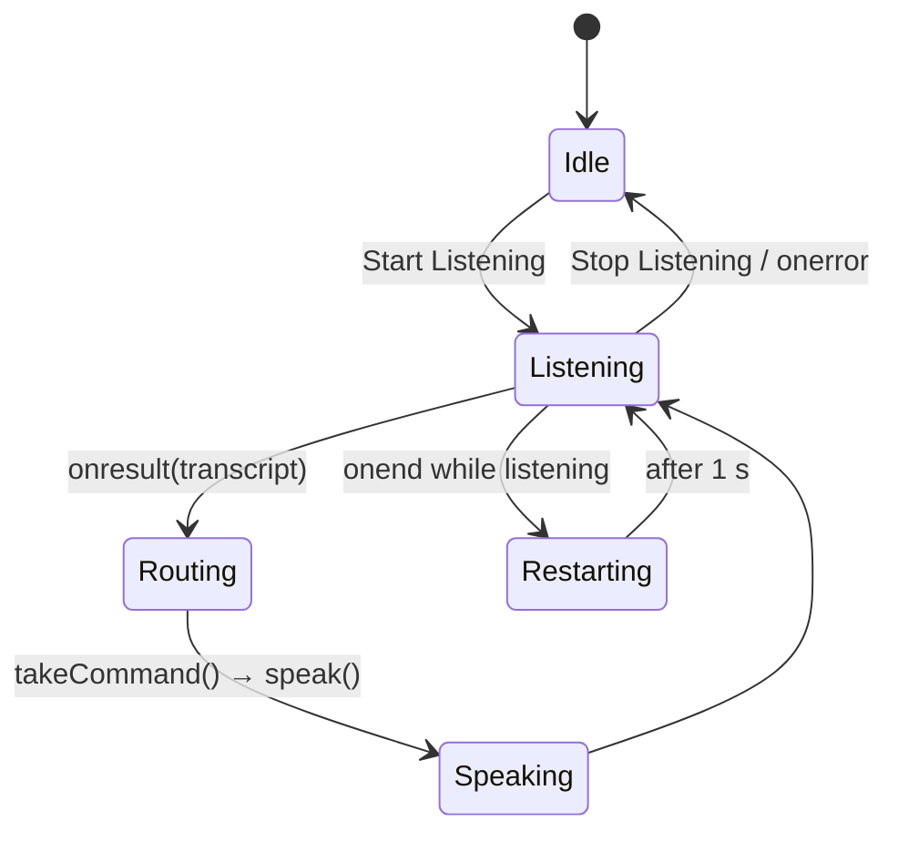

<details>
<summary><b>🎙️ Full command cheat-sheet</b></summary>

Commands are matched by substring, **in this order**, and the first match wins.

| # | Say or type | Result |
|---|---|---|
| 1 | `stop camera` | Stops every media track and clears the overlays |
| 2 | `start camera` | Starts the feed and switches to the Camera panel |
| 3 | `route to <place or lat,lng>` | Draws a Google Directions route and speaks the distance and ETA |
| 4 | `help` · `documentation` | Opens the in-app command documentation |
| 5 | `analyze image` · `analyze frame` | Sends the live frame to Gemini (the camera must be running) |
| 6 | `search equipment <term>` | Filters the inventory, e.g. `search equipment rope` returns 16 items |
| 7 | `hello` · `who are you` · `drone` · `what is ndrf` · `thank you` … | One of 13 canned replies |
| 8 | `weather <city>` | Fetches Open-Meteo weather and runs the risk engine |
| 9 | `time` | Speaks the current time |
| 10 | `date` | Speaks today's date |
| 11 | `human only` | Toggles the person-only detection filter |
| 12 | *anything else* | Suggests saying “help” |

</details>

---

### 3 · Weather risk engine

<div align="center">
</div>

Rules are checked in order and the first one that matches decides the outcome:

| Rule | Decision | Risk | Bar |
|---|---|:-:|:-:|
| `rain > 5 mm` | 🚤 Flood risk: deploy boats and water rescue teams | 🔴 **HIGH** | 90 % |
| `wind > 40 km/h` | 🌪 High wind: stop drones, secure the area | 🟠 **HIGH** | 85 % |
| `temp > 40 °C` | 🔥 Heat risk: activate medical and hydration units | 🟠 **MEDIUM** | 60 % |
| *otherwise* | ✅ Safe conditions, monitoring active | 🟢 **LOW** | 20 % |

The decision is spoken, written to the live log and shown in the dashboard's **AI DECISION** card. HIGH risk also plays the alert beep.

---

### 4 · Route planning (two paths)

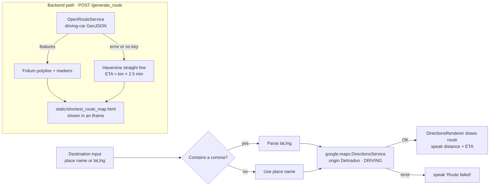

The **live UI** uses Google Directions in the browser. The **backend path** is used by the legacy UI (`script2.js`) and still produces a map when ORS is down, because it falls back to a Haversine estimate.

---

### 5 · Live detection loop

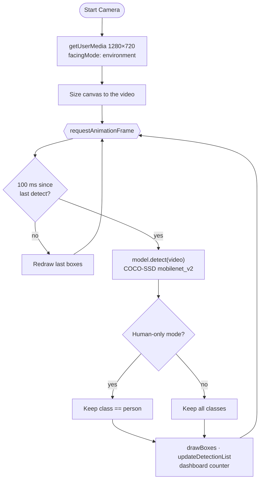


## 🖥️ Command center UI

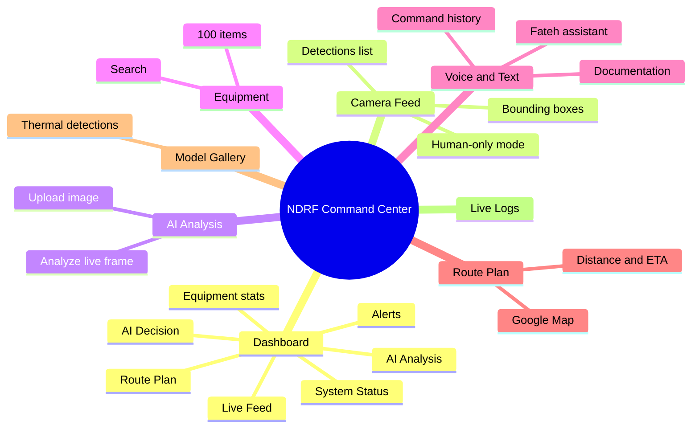

### 🧪 Trained model gallery

Results from the team's custom detector, trained in Colab on drone and thermal imagery and shown in the **Model Gallery** panel:

<table>
<tr>
<td align="center" width="25%">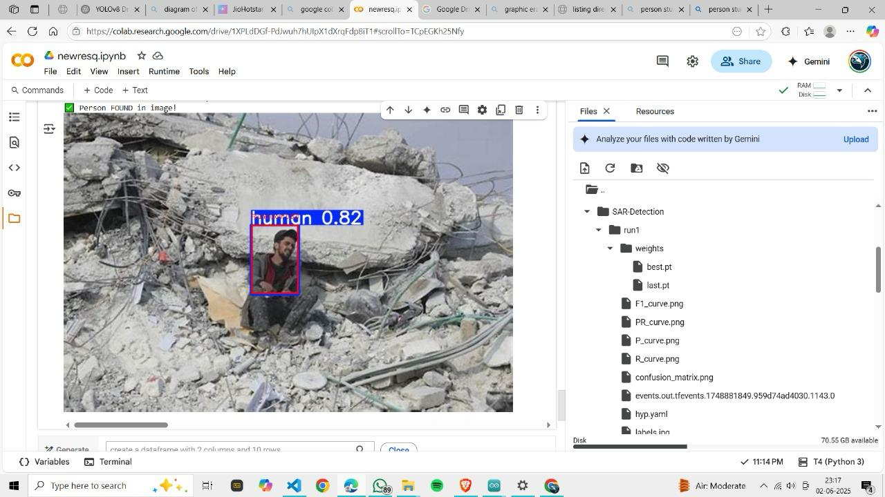<br/><b>Human in debris</b><br/><sub>confidence 85 %</sub></td>
<td align="center" width="25%">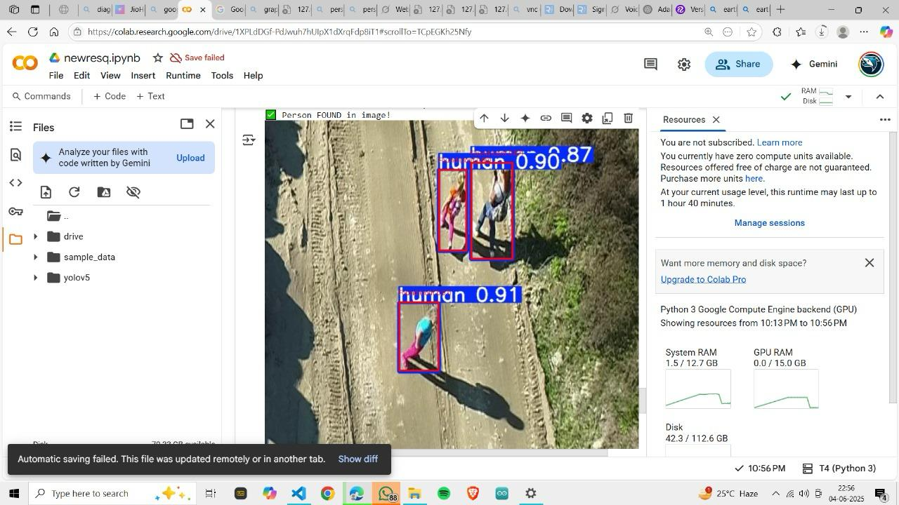<br/><b>Multiple humans · drone camera</b><br/><sub>confidence 90 %</sub></td>
<td align="center" width="25%">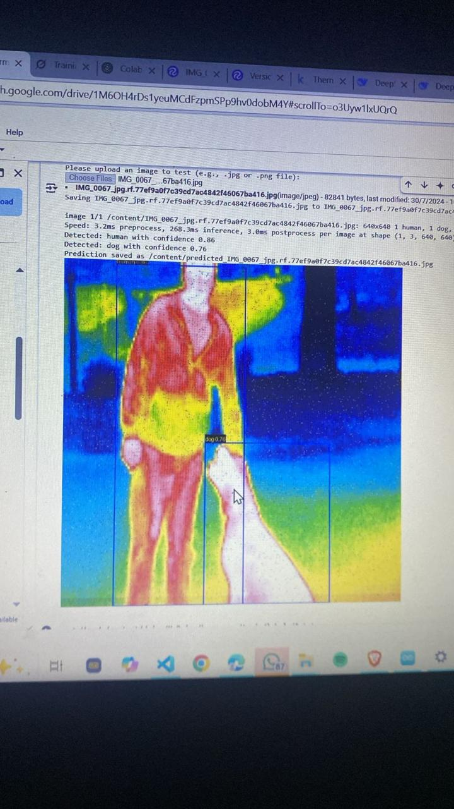<br/><b>Human + animal behind wall · thermal</b><br/><sub>confidence 91 %</sub></td>
<td align="center" width="25%">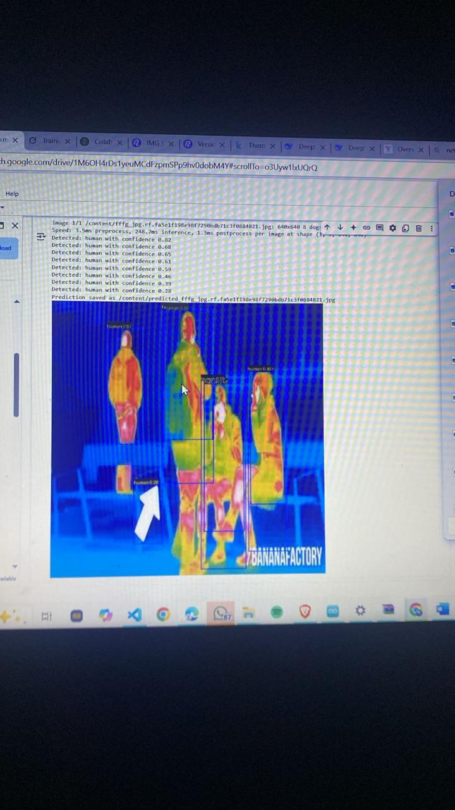<br/><b>Multiple humans · thermal</b><br/><sub>confidence 96 %</sub></td>
</tr>
</table>


## 📡 API reference

The base URL is `http://localhost:10000` locally, or your Render URL in production.

| Method | Endpoint | Body | Response | Used by |
|---|---|---|---|---|
| `POST` | `/analyze_image` | `multipart/form-data` with field `image` | `{ "success": true, "analysis": "…" }` | 🟢 live UI |
| `POST` | `/analyze_frame` | `{ "images": ["data:image/jpeg;base64,…", …] }` | `{ "response": "IMAGE 1 …" }` (batch, reports quota errors per image) | API |
| `POST` | `/gemini` | `{ "query": "…" }` | `{ "response": "1–2 sentence answer" }` | API |
| `POST` | `/voice_command` | `{ "command": "…" }` | `{ "success": true, "command": "…" }`; the answer arrives over Socket.IO | API ⚠️ |
| `POST` | `/generate_route` | `{ "start_lat", "start_lon", "end_lat", "end_lon" }` (all optional) | `{ "success", "distance_km", "duration_min", "map_url" }` | legacy UI |
| `GET` | `/equipment_list` | — | `{ "equipment": "formatted inventory text" }` | API |
| `GET` | `/ping` | — | `{ "status": "ok", "message": "NDRF Base Station API Running" }` | health check |
| `GET` | `/static/<file>` | — | Generated assets such as `shortest_route_map.html` | iframe |

<details>
<summary><b>⚡ Socket.IO events</b></summary>

| Direction | Event | Payload |
|---|---|---|
| server → client | `connected` | `{ message }` |
| client → server | `voice_command` | `{ command }`, handled on a background thread by Gemini |
| server → client | `assistant_response` | `{ text, audio: null }` |
| server → client | `route_generated` | route result (same shape as `/generate_route`) |
| client → server | `request_equipment` | — |
| server → client | `equipment_data` | `{ items: [...] }` |
| server → client | `error` | `{ message }` |

</details>

<details>
<summary><b>🧾 Example: analyse an image with curl</b></summary>

```bash
curl -X POST http://localhost:10000/analyze_image \
     -F "image=@collapsed_building.jpg"
```

```json
{
  "success": true,
  "analysis": "🔍 OBSERVATIONS:\n- Partially collapsed two-storey structure ...\n⚠️ RISK LEVEL: HIGH"
}
```

</details>


## 📂 Project structure

```text
Base-station-NDRF/
├── backend/
│   ├── app.py                 ★ main Flask + Socket.IO server (Gemini, ORS, Folium) · port 10000
│   ├── main2.py               alternative server: /upload_image + /weather, 70-item inventory · port 5000
│   ├── image.py               early prototype: equipment-aware Gemini + GPS-tagged frame analysis
│   ├── requirements.txt       backend dependencies
│   ├── runtime.txt            python-3.11.9
│   ├── voice_assistant.log    runtime log (written by app.py)
│   └── static/
│       └── disaster_equipment (1).xlsx
├── frontend/
│   ├── index.html             ★ live command-center UI  →  loads render2.js
│   ├── render2.js             ★ client logic: camera, COCO-SSD, voice, maps, weather, equipment
│   ├── index2.html            legacy UI  →  loads script2.js (Folium route via backend)
│   ├── script2.js             legacy client logic
│   ├── style.css              neon tactical theme (Orbitron · Rajdhani · Share Tech Mono)
│   ├── 1–4.jpeg, 2.jpg        model gallery + route card images
│   └── static/shortest_route_map.html
├── static/                    generated Folium maps + gallery images (served at /static)
├── public/images/             copy of the gallery images
├── docs/assets/               animated SVGs used in this README
├── requirements.txt           root dependencies (used by Render)
└── runtime.txt                python-3.11.9
```


## 🚀 Quick start

### Prerequisites

- **Python 3.11** (pinned in `runtime.txt`)
- A **Google Gemini API key** from [Google AI Studio](https://aistudio.google.com/)
- *(optional)* an **OpenRouteService key** for backend routing. Without one, the Haversine fallback is used.
- A **Google Maps JavaScript API key** with the Directions API enabled, for the route panel
- **Chrome or Edge.** The Web Speech recognition used by Fateh needs a Chromium browser, and camera and mic access need `localhost` or HTTPS.

### 1. Install

```bash
git clone https://github.com/vansh565/Base-station-NDRF.git
cd Base-station-NDRF/backend
python -m venv .venv
source .venv/bin/activate          # Windows: .venv\Scripts\activate
pip install -r requirements.txt
pip install openpyxl               # only needed if you add Excel inventories
```

### 2. Configure

<table>
<tr><th>bash / zsh</th><th>PowerShell</th></tr>
<tr><td>

```bash
export GOOGLE_API_KEY="your-gemini-key"
export ORS_API_KEY="your-ors-key"
```

</td><td>

```powershell
$env:GOOGLE_API_KEY = "your-gemini-key"
$env:ORS_API_KEY    = "your-ors-key"
```

</td></tr>
</table>

| Variable | Read by | Purpose |
|---|---|---|
| `GOOGLE_API_KEY` | `app.py` | Gemini vision and text |
| `GEMINI_API_KEY` | `main2.py` | Same purpose, different variable name in the alternative server |
| `ORS_API_KEY` | `app.py`, `main2.py` | OpenRouteService directions |
| *Maps JS key* | `frontend/index.html` (script tag) | Google Maps and Directions in the browser |

### 3. Point the frontend at your backend

`render2.js` is hard-wired to the hosted backend. For local development, change both lines to your local server:

```js
// frontend/render2.js
const socket   = io("http://localhost:10000");      // line 30
const API_BASE = "http://localhost:10000";          // line 50
```

### 4. Run

```bash
python app.py
# → open http://localhost:10000
```

Then allow camera and microphone access, click **Start Camera**, and say **“hello”** to Fateh. 🎉


## ☁️ Deployment (Render)

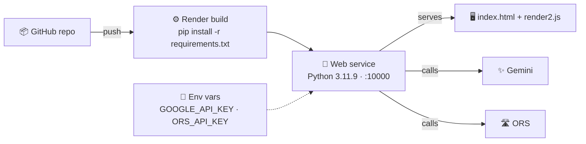

| Setting | Value |
|---|---|
| Runtime | Python 3 (version from `runtime.txt`) |
| Build command | `pip install -r requirements.txt` |
| Start command | `cd backend && python app.py` (binds `0.0.0.0:10000`, Render's default port) |
| Environment | `GOOGLE_API_KEY`, `ORS_API_KEY` |

> [!NOTE]
> On Render's free tier the filesystem is temporary, so the generated `shortest_route_map.html` and the log file are wiped on every redeploy. Free services also spin down when idle, so the first request after a pause can take up to a minute.


## 🧰 Tech stack

| Layer | Technology |
|---|---|
| **Frontend** | Vanilla JS, HTML5, CSS3 (neon tactical theme), Google Fonts (Orbitron, Rajdhani, Share Tech Mono) |
| **On-device ML** | TensorFlow.js 3.18 + COCO-SSD 2.2.2 (mobilenet_v2) |
| **Speech** | Web Speech API: `SpeechRecognition` (en-IN) + `SpeechSynthesis` |
| **Maps** | Google Maps JS API + DirectionsService · Folium 0.17 / Leaflet (backend) |
| **Backend** | Flask 2.3.3 · Flask-SocketIO 5.3.6 · Flask-CORS · Pillow · pandas · requests |
| **AI** | Google Gemini via `google-generativeai` 0.8.3 |
| **Data APIs** | Open-Meteo (geocoding + forecast) · OpenRouteService (directions) |
| **Hosting** | Render (Python 3.11.9) |
| **Model training** | Custom thermal and drone detector trained in Google Colab (see gallery) |


## 🩺 Code health & known issues

These come from a full read of the code and the 7,400-line runtime log. The log contains **352 errors**: 243 are Gemini **429 quota** errors and 61 are **404 model not found** errors for `gemini-1.5-flash`.

<details>
<summary><b>🔐 Security (fix first)</b></summary>

- [`backend/image.py:12`](backend/image.py#L12) **hard-codes a Gemini API key**. Revoke it in Google AI Studio (it is in the git history) and read it from `GOOGLE_API_KEY` instead.
- [`frontend/index.html:578`](frontend/index.html#L578) ships the Google Maps key in the page. That is normal for Maps JS, but **restrict the key by HTTP referrer** in Google Cloud.
- Model output and speech transcripts are written with `innerHTML` ([`render2.js:770`](frontend/render2.js#L770), [`:814`](frontend/render2.js#L814), [`:847`](frontend/render2.js#L847)). Switch to `textContent` to rule out HTML injection.
- CORS and Socket.IO accept every origin (`*`). Restrict them to the deployed domain.

</details>

<details>
<summary><b>🐞 Correctness</b></summary>

- [`app.py:25-34`](backend/app.py#L25-L34): `app` and `socketio` are created **twice**, and the second (threading mode) wins.
- [`app.py:335`](backend/app.py#L335) **redefines** `ask_gemini_with_context`. The first version at [`:213`](backend/app.py#L213), which routes weather, route and equipment intents, can never run, so every voice command goes straight to Gemini.
- `current_command_id` is never set at module level, so `POST /voice_command` and the `voice_command` socket event fail with `NameError` and return HTTP 500.
- `voice_bot_loop` / `start_voice_bot` ([`app.py:351-447`](backend/app.py#L351-L447)) use `asyncio`, `voice_loop`, `listen_and_caption` and `is_activated`, none of which are defined, and nothing ever calls them. As a result `speechrecognition`, `edge-tts` and `nest-asyncio` are unused dependencies.
- The `/script.js` route serves a file that was deleted. The live UI loads `render2.js` through the static folder.
- `read_all_equipment()` looks for `earthquake_kit.xlsx`, `flood_kit.xlsx` and `mfr_equipment.xlsx`, which are not in the repo, and `openpyxl` is missing, so it always uses the built-in list. The committed `disaster_equipment (1).xlsx` is never read.
- [`render2.js:415`](frontend/render2.js#L415) ends the equipment table with stray characters instead of `</table>`.
- The **Fullscreen** button has no click handler, and the dashboard's *System Status* indicators are static HTML.
- Model names differ between files: `gemini-3-flash-preview` (`app.py`), `gemini-1.5-flash` (`main2.py`, which returns 404 in the logs) and `gemini-2.0-flash` (`image.py`).
- The default routes disagree: the frontend starts from Dehradun `(30.3165, 78.0322)` and the backend defaults to India Gate → Red Fort, Delhi.

</details>

<details>
<summary><b>🧹 Housekeeping</b></summary>

- `voice_assistant.log` (≈400 KB) is committed. Add a `.gitignore` covering `*.log`, `__pycache__/`, `.venv/`, `uploads/` and `uploaded_images/`.
- There are two `requirements.txt` files with different pins (`pandas 2.2.2` vs `2.1.4`). `eventlet` appears twice even though the server runs in `threading` mode.
- The gallery images exist in three places (`frontend/`, `static/images/`, `public/images/`).
- `API_BASE` is hard-coded to production. Using a relative `""` would make one build work both locally and on Render.
- There is no `LICENSE` file, so by default nobody else may reuse the code.

</details>


## 🛣️ Roadmap

- [ ] Move every secret to environment variables and rotate the exposed key
- [ ] Merge `app.py` / `main2.py` / `image.py` into a single server with one model config
- [ ] Bring back the server-side intent router and initialise the command counter
- [ ] Serve the custom thermal model in the browser (TF.js / ONNX) next to COCO-SSD
- [ ] GPS-tag analysed frames (the prompt in `image.py` already accepts coordinates)
- [ ] Live equipment stock: load the Excel inventory and record issue and return
- [ ] Multi-drone feeds and shared incident state over Socket.IO
- [ ] Offline-first mode for sites with patchy connectivity
- [ ] Add a `LICENSE`, `.gitignore`, and CI linting


## 📅 Build log

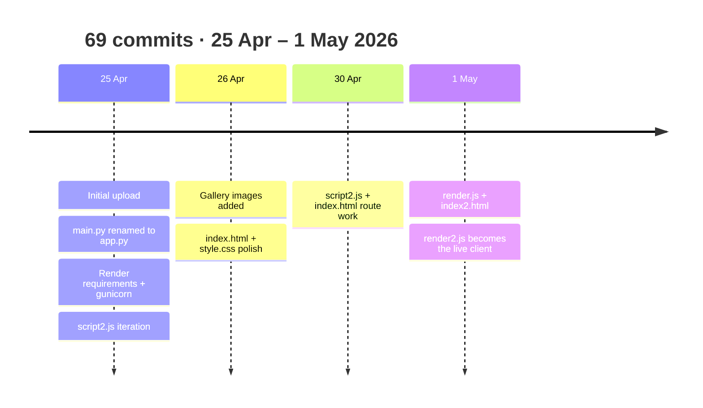


<div align="center">

### 🙏 Acknowledgements

Built for the **National Disaster Response Force (NDRF)** and **State Disaster Response Forces (SDRF)** of India.<br/>
Powered by [Google Gemini](https://ai.google.dev/), [TensorFlow.js](https://www.tensorflow.org/js), [Open-Meteo](https://open-meteo.com/), [OpenRouteService](https://openrouteservice.org/), [Folium](https://python-visualization.github.io/folium/) and [Google Maps Platform](https://developers.google.com/maps).

Made by [vansh565](https://github.com/vansh565) · *Every second counts.* 🚁


</div>
